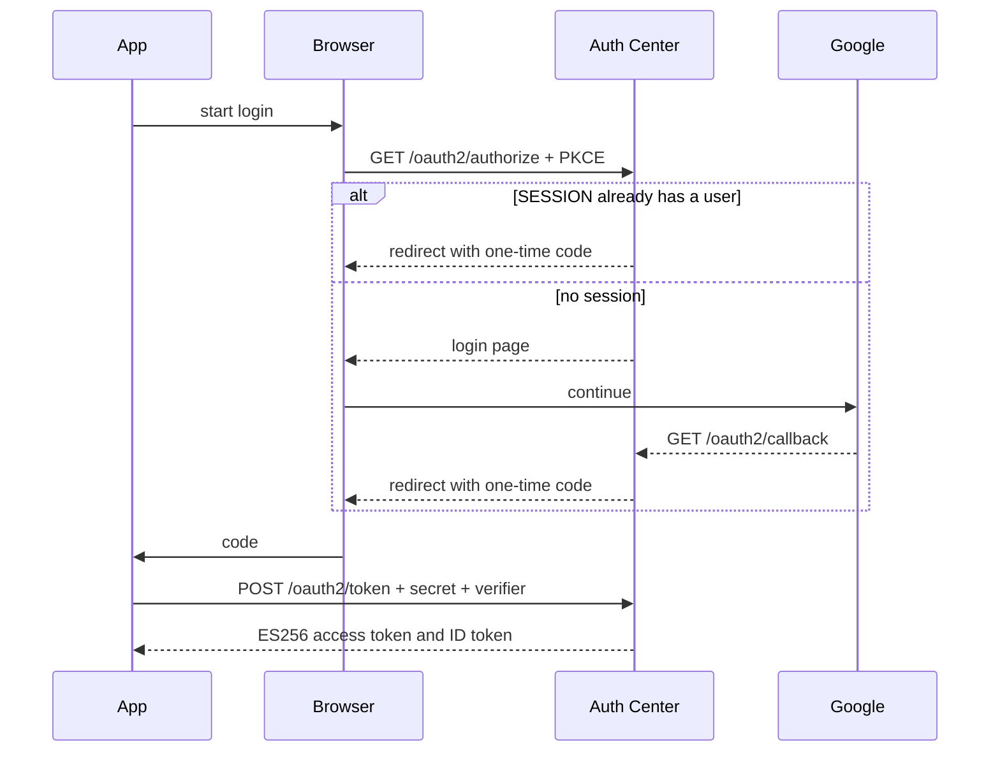

# Architecture

`server/` (Spring Boot, Java 25) talks to PostgreSQL. `client/` (Next.js) is the login page and a small dashboard. Users, OAuth clients, authorization codes, and sessions are in Postgres. A parked authorize request and an in-flight Google login live in memory and disappear on restart.

The redirect URI has to match the registered value exactly. The code cannot be used twice. `GET /oauth2/userinfo` checks the access token.

Direct sign-in, with no app waiting, uses `POST /api/auth/sign-in/social` and lands on the dashboard. `GET /api/auth/get-session` reads the cookie. `POST /sign-out` clears it.

The cookie is HttpOnly and `SameSite=Lax`. It is `Secure` only in production. `/oauth2/**`, `/api/auth/**`, and `/sign-out` are public. CORS allows the login origin with credentials.

Startup inserts the configured OAuth client when that `client_id` is missing. `schema.sql` is the prod schema. Locally Hibernate updates tables itself.
